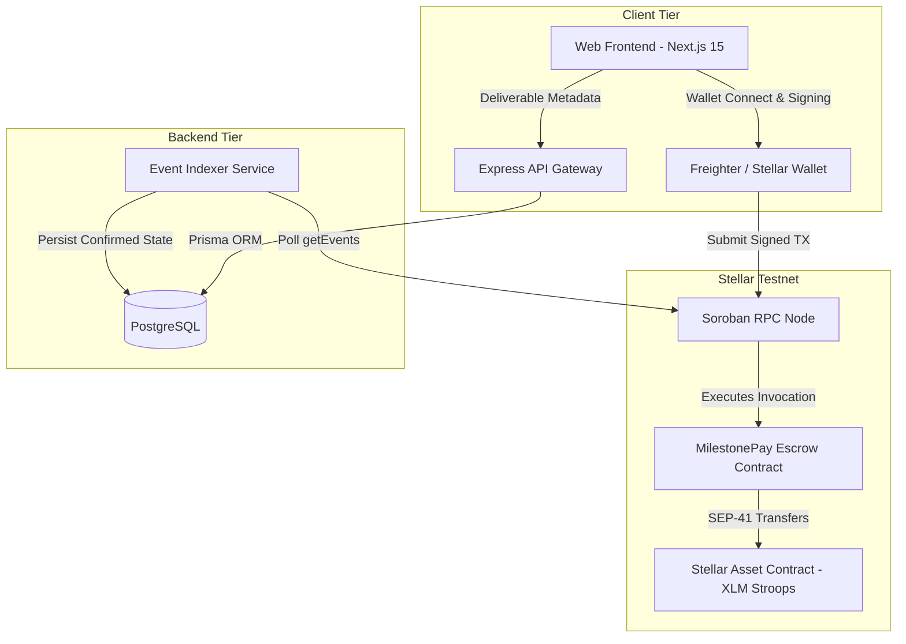

# MilestonePay

> **Milestone-based freelance escrow on Stellar Soroban (Testnet MVP).**

[](https://github.com/oaks-labs/milestone-pay/actions)
[](./LICENSE)
[](https://developers.stellar.org/docs/smart-contracts)
[](https://stellar.expert/explorer/testnet)

MilestonePay helps freelancers, independent developers, and small agencies agree on deliverables, fund milestones into Soroban smart-contract escrow, and release payment upon explicit client approval.

Stellar performs the actual escrow custody and token settlement on-chain via the Stellar Asset Contract (SAC). Off-chain metadata and deliverable links are indexed by an Express + PostgreSQL service that treats confirmed Soroban contract events as the sole authoritative source for financial state transitions.

> **Verification & Audit Status**: This repository is an open-source **Stellar Testnet MVP**. It has **not** undergone an independent third-party security audit, is **not** deployed to Stellar Mainnet, and makes no claim of program eligibility or endorsement. Review the verified release report in [`RELEASE_READINESS_REPORT.md`](./RELEASE_READINESS_REPORT.md).

---

## 1. Problem & Design Scope

### The Problem
- **Freelancers** risk non-payment after delivering work.
- **Clients** risk losing upfront deposits if deliverables are never completed.
- **Centralized Escrow Platforms** charge high fees and hold custodial control over funds.

### Verified Capabilities & Explicit Limitations
1. **Immutable Agreement Parameters**: Agreements record `client`, `freelancer`, and `token` addresses in Soroban persistent storage.
2. **On-Chain Escrow Custody**: `fund_milestone` transfers stroops from the client to the contract via SEP-41 token interface (`token::Client`).
3. **Informational Deliverable References**: Freelancers submit deliverable links (PRs, commits, URLs) off-chain. Deliverable submission is strictly informational and **cannot** trigger payment release.
4. **Explicit Client Release**: `release_milestone` requires `client.require_auth()` and transfers escrowed tokens only to the stored `freelancer` address.
5. **Mutual Refund Requirement**: `refund_milestone` requires cryptographic authorization from **both** `client` and `freelancer`. Neither party can unilaterally seize funded escrow.
6. **Dispute Limitation**: This contract does **not** include an arbitrator or automatic deadline release. If client and freelancer dead-lock and refuse to co-sign a mutual refund or release, funds remain locked in the contract until mutual agreement is reached.
7. **Storage Archival & Recovery**: Contract methods extend persistent storage TTLs (`extend_ttl(50_000, 100_000)`). If an agreement is inactive for more than `100,000` ledgers (~7 days) and enters Soroban state archival, either party can recover access by submitting a standard Stellar `RestoreFootprintOp` transaction before invoking `release_milestone` or `refund_milestone` (see [`docs/ARCHITECTURE.md`](./docs/ARCHITECTURE.md)).

---

## 2. Architecture & Monorepo Layout



### Monorepo Structure
```
milestone-pay/
├── contracts/
│   └── escrow/            # Soroban smart contract in Rust (soroban-sdk v21.7.7)
├── packages/
│   ├── shared/            # Shared Zod validation schemas, domain types & BigInt stroop math
│   └── sdk/               # Typed TypeScript client & runnable mutual-refund multi-sig demo
├── apps/
│   ├── api/               # Express API, custom ed25519 challenge auth, rate limiter & indexer
│   └── web/               # Next.js 15 frontend with Tailwind CSS & role-based escrow views
├── scripts/
│   └── testnet-validate.ts # Live Stellar Testnet deployment & end-to-end validation script
├── docs/                  # Architecture, Threat Model, State Machine & Contributor Issues
└── docker-compose.yml     # Local PostgreSQL 16 container configuration
```

---

## 3. Contract State Machine

| Current State | Function | Required Auth | Target State | Token Movement |
| :--- | :--- | :--- | :--- | :--- |
| *(None)* | `create_agreement` | `client` | `Created` (Unfunded) | None |
| `Created` | `fund_milestone` | `client` | `Funded` (In Escrow) | Client $\to$ Contract (`amount`) |
| `Created` | `cancel_milestone` | `client` | `Cancelled` (Terminal) | None |
| `Funded` | `release_milestone` | `client` | `Released` (Terminal) | Contract $\to$ Freelancer (`amount`) |
| `Funded` | `refund_milestone` | `client` **AND** `freelancer` | `Refunded` (Terminal) | Contract $\to$ Client (`amount`) |
| `Released` / `Refunded` / `Cancelled` | *Any* | — | **REJECTED (`InvalidState`)** | None |

---

## 4. Reproducible Local Setup

### Prerequisites
- **Node.js**: `v22.x` (`npm 10+`)
- **Rust**: `1.84+` with target `wasm32v1-none` (`rustup target add wasm32v1-none`)
- **Docker**: For running local PostgreSQL 16 (or a local PostgreSQL instance)

### 1. Clean Install Dependencies
```bash
npm ci
```

### 2. Start PostgreSQL & Apply Committed Migrations
> **Important**: `prisma generate` only generates TypeScript types. You must run `prisma migrate deploy` (or `prisma migrate dev`) to create the PostgreSQL tables from [`apps/api/prisma/migrations/`](./apps/api/prisma/migrations).

```bash
# Start PostgreSQL container
docker compose up -d

# Apply committed SQL migrations to PostgreSQL
npx prisma migrate deploy --schema=./apps/api/prisma/schema.prisma

# Generate Prisma TypeScript client
npm run prisma:generate --workspace=@milestone-pay/api
```

### 3. Start Development Services
```bash
# Terminal 1: Start API Gateway & Event Indexer (Port 4000)
npm run dev --workspace=@milestone-pay/api

# Terminal 2: Start Next.js Frontend (Port 3000)
npm run dev --workspace=@milestone-pay/web
```

---

## 5. Verification & Test Suites

Tests are strictly separated by execution environment:

```bash
# 1. Soroban Smart Contract Unit Tests (15 Rust tests with locked dependencies)
cd contracts/escrow
cargo test --locked
cargo build --target wasm32v1-none --release --locked
cd ../..

# 2. Typecheck All TypeScript Workspaces
npm run typecheck

# 3. SDK Unit Tests & Runnable Mutual-Refund Multi-Sig Example
npm run test --workspace=@milestone-pay/sdk
npm run example:mutual-refund --workspace=@milestone-pay/sdk

# 4. API & Indexer Tests (In-Memory Adapter - 12 tests)
npm run test --workspace=@milestone-pay/api

# 5. Real PostgreSQL Database Integration Tests (Requires running PostgreSQL)
npm run test:db --workspace=@milestone-pay/api

# 6. Browser / UI Component Tests (10 tests)
npm run test --workspace=@milestone-pay/web

# 7. Live Stellar Testnet Deployment & On-Chain Flow Validation
npx tsx scripts/testnet-validate.ts
```

---

## 6. Security & Authentication Notes

- **Custom Ed25519 Signed-Message Auth (Not SEP-10)**: The API authenticates wallet ownership using single-use, 5-minute expiring UTF-8 challenges bound to domain, public key, and network passphrase (`apps/api/src/auth/challenge.ts`). It does **not** implement SEP-10 transaction envelopes because the backend holds zero Stellar signing keys.
- **Rate Limiting & Payload Boundaries**: Authentication endpoints enforce a `10 req/min/IP` sliding window (`429 Too Many Requests`), and JSON bodies are capped at `50kb` (`413 Payload Too Large`). These mitigate basic scripted abuse but do not replace edge DDoS protection (see [`SECURITY.md`](./SECURITY.md)).

---

## 7. License

Licensed under the **Apache License, Version 2.0**. See [`LICENSE`](./LICENSE) for details.
