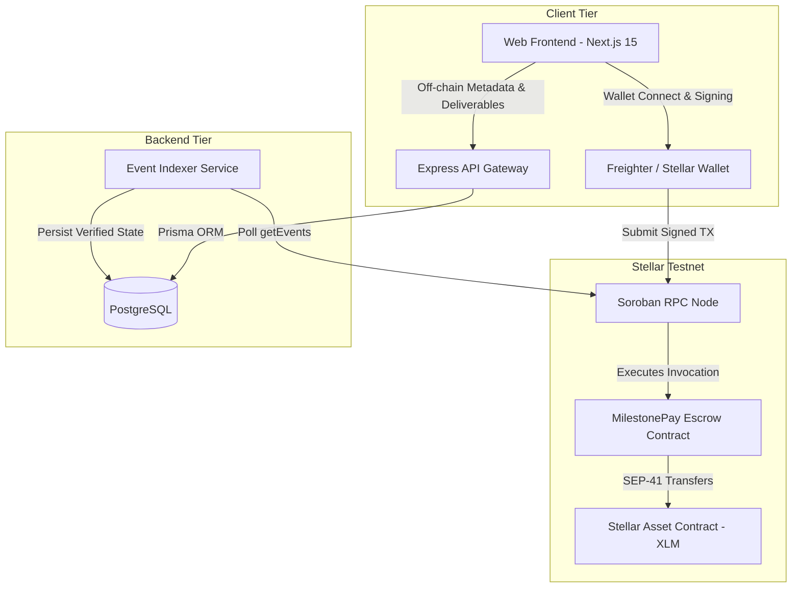

# MilestonePay Architecture

## 1. Monorepo Organization

```
milestone-pay/
├── contracts/
│   └── escrow/            # Soroban smart contract (Rust, Soroban SDK v21)
├── packages/
│   ├── shared/            # Shared validation schemas & domain models (Zod / TypeScript)
│   └── sdk/               # Typed client library for contract operations, RPC & multi-sig examples
├── apps/
│   ├── api/               # Express/Node API with OpenAPI docs, ed25519 challenge auth & event indexer
│   └── web/               # Next.js 15 frontend with Tailwind CSS & Freighter / Testnet wallet support
├── scripts/
│   └── testnet-validate.ts # End-to-end live Stellar Testnet deployment & invariant validation script
├── docs/                  # System documentation, threat model, state machine & contributor backlog
├── docker-compose.yml     # PostgreSQL service for off-chain metadata & indexer state
└── package.json           # Root workspace configuration
```

## 2. Component Architecture



## 3. Soroban Storage Archival, TTL Extension & Restoration

Soroban enforces explicit state archival to bound ledger bloat. MilestonePay uses two storage tiers:
- **Instance Storage**: Stores `DataKey::AgreementCount` (the monotonically increasing agreement sequence counter).
- **Persistent Storage**:
  - `DataKey::Agreement(u64)`: Holds immutable agreement participants (`client`, `freelancer`, `token`), creation timestamp, and milestone count.
  - `DataKey::Milestone(u64, u32)`: Holds individual milestone `amount` (in stroops) and `status` (`Created`, `Funded`, `Released`, `Refunded`, `Cancelled`).

### Active TTL Renewal (`extend_ttl`)
- `INSTANCE_BUMP_THRESHOLD` / `PERSISTENT_BUMP_THRESHOLD`: `50,000` ledgers (~3.5 days at 5s/ledger).
- `INSTANCE_EXTEND_TO` / `PERSISTENT_EXTEND_TO`: `100,000` ledgers (~7 days).
- Every contract mutation (`create_agreement`, `fund_milestone`, `release_milestone`, `refund_milestone`, `cancel_milestone`) and read (`get_agreement`, `get_milestone`) calls `extend_ttl(50_000, 100_000)`. Whenever an entry's remaining TTL drops below `50,000` ledgers, the invocation automatically extends its lifetime back to `100,000` ledgers.
- This renewal behavior is verified in `contracts/escrow/src/test.rs::test_storage_ttl_extension_across_ledger_advancement`.

### Recovery After Prolonged Inactivity (`RestoreFootprintOp`)
- Unlike `temporary()` storage (which is permanently deleted upon expiration), `persistent()` and `instance()` entries are **never destroyed** when their TTL reaches 0—they move to the **ess-archived state** in the Stellar ledger bucket list.
- If an escrow agreement remains completely untouched for longer than `100,000` ledgers (~7 days), subsequent contract calls targeting that agreement will return a Soroban simulation restoration notice (`restorePreamble` in `simulateTransaction`).
- **How Parties Recover Access**:
  1. Either party (or any third party) simulates the intended contract call (`get_milestone`, `release_milestone`, or `refund_milestone`) via Soroban RPC `simulateTransaction`.
  2. When the RPC response contains a non-empty `restorePreamble`, the caller submits a standard Stellar transaction containing `Operation.restoreFootprint({})` configured with `restorePreamble.transactionData` (which specifies the archived `DataKey::Agreement(id)` and `DataKey::Milestone(id, ms_id)` in the read-write footprint).
  3. Once `RestoreFootprintOp` confirms on-chain, the persistent entries are restored to live ledger state with a fresh TTL, and the party can immediately execute `release_milestone` or `refund_milestone`. Escrowed tokens held by the Stellar Asset Contract (SAC) are similarly recoverable via `RestoreFootprintOp` on the contract's SAC balance key.

## 4. Authentication & Off-Chain Authorization Model

### Custom Ed25519 Signed-Message Protocol (Not SEP-10)
MilestonePay implements a **custom ed25519 signed-message challenge-response protocol** rather than SEP-10 (Stellar Web Authentication):
- **Why not SEP-10?**: Full SEP-10 requires the backend server to hold an operational Stellar signing keypair (`SERVER_SIGNING_KEY`) to co-sign a Stellar XDR transaction envelope containing `ManageData` operations. Because MilestonePay's backend is designed to hold **zero Stellar private keys**, it avoids server key management entirely.
- **How the Custom Protocol Works**:
  1. Client requests `POST /api/auth/challenge` with their Stellar `publicKey` (`G...`).
  2. API generates a 32-byte cryptographic random hex `nonce`, persists an `AuthChallenge` record with a 5-minute expiration (`expiresAt`) and `used: false`, and returns the canonical UTF-8 challenge string:
     `{domain} auth challenge for {publicKey} on {networkPassphrase}: {nonce}`
  3. User signs the UTF-8 message bytes using their wallet's ed25519 key and submits `{ publicKey, nonce, signature }` to `POST /api/auth/verify`.
  4. API verifies the ed25519 signature via `Keypair.fromPublicKey(publicKey).verify(...)` and atomically consumes the challenge via ` prisma.authChallenge.updateMany({ where: { id, used: false }, data: { used: true } })`, preventing both sequential and concurrent TOCTOU replay attacks.

### Authoritative On-Chain State vs. Informational Off-Chain Deliverables
- **Authoritative Financial State**: Only `IndexerService` polling confirmed Soroban contract events (`ag_create`, `ms_fund`, `ms_rel`, `ms_ref`, `ms_canc`) from Soroban RPC can transition a milestone's database status to `FUNDED`, `RELEASED`, `REFUNDED`, or `CANCELLED`. Browser requests cannot mark a milestone funded or released.
- **Informational Deliverables**: `POST /api/projects/milestones/:id/deliverable` allows only the designated `freelancerAddress` to attach a deliverable URL and notes. It never alters escrow state or triggers token movement.

## 5. Rate Limiting & Request-Size Limits

- **Request Body Size Limit**: `express.json({ limit: "50kb" })` and `express.urlencoded({ limit: "50kb" })` reject oversized payloads with HTTP `413 Payload Too Large`.
- **Auth Rate Limiting**: `createRateLimiter` in `apps/api/src/middleware/rateLimit.ts` enforces a sliding window of `10 requests / 60 seconds` per client IP on `/api/auth/*`, returning HTTP `429 Too Many Requests` with `Retry-After` headers.
- **Security Boundary**: These application-layer controls mitigate basic automated script flooding and memory exhaustion, but **do not provide network-layer DDoS protection**. Public deployments must sit behind an edge reverse proxy / WAF (e.g., Cloudflare, AWS Shield, or Nginx rate-limiting zones).
